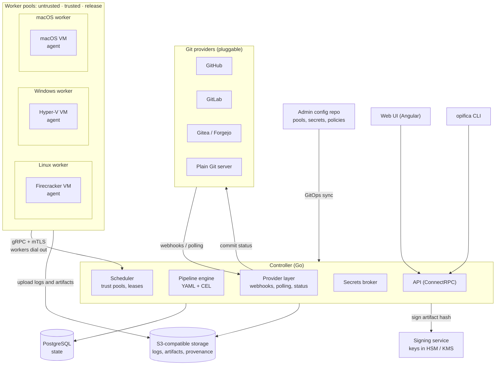

# Opifica

**Open-source CI/CD, built in the EU. Every job runs in a fresh virtual machine on Linux, Windows or macOS.**

Opifica is a self-hosted build system that an organisation runs on its own hardware. You describe what should
happen to each branch, pull request and tag in a declarative YAML file inside your repository. Opifica builds,
tests and releases your software on a fleet of workers, and gives every job a clean VM that is destroyed afterwards.
That way a compromised build can never infect the next one.

> **Status:** early design and development. Nothing is ready for production yet.

## Why Opifica

- **A clean VM for every job, on every OS.** Linux (Firecracker), Windows (Hyper-V) and macOS (Apple
  Virtualization.framework). Nothing a job does survives it.
- **Built for supply-chain security.** Separate trust pools for pull requests, main branches and releases.
  Signing keys never touch a build machine. Every artifact gets signed provenance.
- **Bring your own Git.** Pluggable providers for GitHub, GitLab, Gitea/Forgejo or a plain Git server.
- **Everything as code.** Developers write pipelines in their repository. Admins manage workers, pools, secrets
  and policies in a separate Git repository (GitOps).
- **Sovereign by default.** Fully self-hostable, no required calls to services outside your control,
  and licensed under the [EUPL-1.2](https://interoperable-europe.ec.europa.eu/collection/eupl).

## Architecture



### How a build flows

1. **Event:** a push, pull request or tag reaches the controller through a provider, via webhook or polling.
   The event is pinned to an exact commit SHA.
2. **Plan:** the controller reads `.opifica/pipeline.yaml` at that commit. It applies the admin policy and
   routes each job to a trust pool. The pool is chosen by the controller, never by the pipeline file.
3. **Schedule:** a worker with the right OS, architecture and pool takes the job from its warm pool of
   pre-booted VMs.
4. **Run:** the agent inside the VM gets the source from the worker's local Git mirror and runs the steps.
   Secrets arrive at runtime, are held in memory only, and are masked in logs.
5. **Report:** logs, test results and artifacts go to object storage. Provenance is recorded and the status
   is sent back to the forge.
6. **Destroy:** the VM is thrown away and a fresh one boots in the background.

### Components

| Component | Language | Role |
|---|---|---|
| **controller** | Go | API, provider integration, pipeline engine, scheduler, secrets broker |
| **worker** | Go | Runs on each build machine, manages the hypervisor and the warm pool of VMs |
| **agent** | Go | Runs inside each VM, executes steps, streams logs, uploads results |
| **signer** | Go | Optional service that signs release artifacts; keys never leave it |
| **web** | Angular | Web UI for pipelines, runs, logs, workers and administration |
| **opifica** | Go | CLI for developers and admins |

### A pipeline, for example

```yaml
on:
  push:         { branches: [main] }
  pull_request: {}
  tag:          { pattern: "v*" }

jobs:
  test:
    matrix: { os: [linux, windows, macos] }
    runs-on: { os: ${{ matrix.os }} }
    steps:
      - run: make test
      - report: junit build/test-results/*.xml

  release:
    needs: [test]
    if: event.tag != ""
    runs-on: { os: macos, image: xcode-16 }
    steps:
      - run: make dist
      - sign: dist/*.dmg
```

## Repositories

| Repository | Description |
|---|---|
| [opifica](https://github.com/opifica/opifica) | Core services: controller, worker, agent, signer, CLI, API definitions and the pipeline language |
| [web](https://github.com/opifica/web) | Angular web UI |
| [images](https://github.com/opifica/images) | Packer recipes for the golden VM images (Linux, Windows, macOS) |

## License

Opifica is licensed under the [European Union Public Licence v1.2 (EUPL-1.2)](https://interoperable-europe.ec.europa.eu/collection/eupl).
